# How Polymarket's 5-minute BTC market prices, how fast it follows Binance, and who makes money

Research notebooks and results, built from market data I captured in March and April 2026 and six months of public
Binance trades.
Andrej Petrovic, BSc Data Science and Engineering, Universidad Carlos III de Madrid.

**Data period.** Polymarket and Binance live capture: **21 March to 5 April 2026** (16 days; notebooks 01 to 03).
Earlier Binance-only capture: **9 to 18 March 2026** (notebook 04 and the out-of-sample check in notebook 05). Lookup
table: Binance's public trades from **September 2025 to February 2026** (notebook 05). All dates UTC;
[details per notebook](#data-behind-each-notebook).

**In short**

1. Polymarket runs a new "will Bitcoin be higher in 5 minutes?" market every 5 minutes. I recorded its best bid and ask,
   every trade in it and every Binance trade on one clock for 16 days (about 4,500 markets), plus 9 days of Binance
   alone.
2. When a Binance move shifts the fair price by 3¢ or more, Polymarket's price has 61% of the move after half a second
   and 83% after one second. Buying straight after the move and holding to settlement made 3.6¢ a share after the fee,
   0.85¢ half a second later and nothing from 0.7 s on. This fits a latency race, which Budish, Cramton and Shim
   (2015) show is part of the Nash equilibrium of a continuous order book.
3. Valuing all 18.1 million recorded trades at settlement: takers trading right after a Binance move their way made
   $65k a day; makers lost $100k a day to them but made $118k a day overall, winning it back from takers with no Binance move behind
   them;
   Polymarket kept $176k a day in fees.
4. The market's own price is well calibrated: on average within about one percentage point of how often markets
   actually settled Up. Its Brier score is 0.22 early in the market and 0.13 in the last 100 seconds.
5. From six months of Binance trades (828 million) I built a lookup table of how Bitcoin moves, by volatility and time
   left, without assuming a shape for the distribution. On later data it never saw, its probabilities are within 0.7
   percentage points of how often the outcome happened with 60 s left, against 2.8 for a Normal distribution with the
   same spread.
6. It did not become a profitable strategy. The main obstacle is that the market settles on Chainlink's price, not
   Binance's, and converting between the two added more error than the table could make up.

> **Read this first.**
> * **I did not find an edge I could use.** The stale quotes after a Binance move are worth money, but only to whoever
>   gets there first, and nothing here shows that a model beats the market's own price.
> * **The code was written by an AI assistant (Claude) from my instructions.** I chose the questions, ran the data
>   capture, the notebooks and the order tests, and judged the results. Some experiments are left out
>   ([what and why](#what-is-not-in-this-repo)).
> * **The data is not included.** Every notebook keeps the printed outputs and charts of my own run, so everything can
>   be read without re-running anything.

## How the market works

Every 5 minutes, Polymarket opens a new market with one question: will Bitcoin be higher at the end of these 5 minutes
than at the start? The reference price, the strike, is the last Chainlink BTC/USD price before the market opens. The
market settles Up if the last Chainlink price at the close is at or above the strike, and Down otherwise. That closing
price is also the strike of the next market, so the markets run back to back.

There are two tokens, Up and Down, and the winning one pays $1. A price of 0.60 for Up reads as roughly a 60% chance
that Bitcoin finishes higher: roughly, because it is the price someone is willing to trade at, not a measured
probability. Market makers post the price at which they will buy (the bid) and sell (the ask); a taker trades
instantly by paying the gap between them, the spread, which is 1¢ most of the time. Buying Down is the same as selling
Up, so the two tokens trade in one book.

So the market gives a range rather than one probability: the true chance should sit between the bid and the ask. In
[notebook 02](notebooks/02_polymarket_orderbook_calibration.ipynb) I scored the bid, the mid and the ask as three
forecasts. All three are within about one percentage point of what happened. Testing whether the outcome rate falls
between bid and ask at each price would need far more markets: even with all 4,544, a 95% interval for one price level
is about 3 points wide, three times the 1¢ range being tested.

### What a fair price needs

Imagine every way Bitcoin could move between now and the close: that gives a distribution of final prices. The part
above the strike is the chance of Up, the part below the chance of Down. With less time left the distribution narrows,
so the same distance from the strike means a more certain answer. The distribution is never known exactly, so pricing
this market comes down to estimating it.

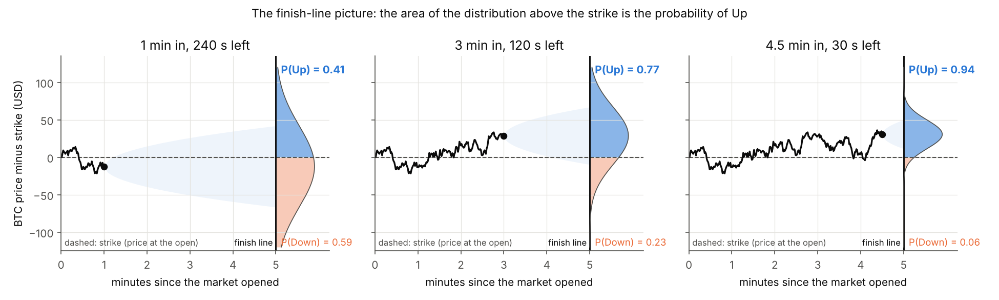

*Illustration (simulated path, Normal distribution). The real distribution has fatter tails, see
[notebook 03](notebooks/03_return_distributions_by_regime.ipynb).*

### The market gets steeper as time runs out

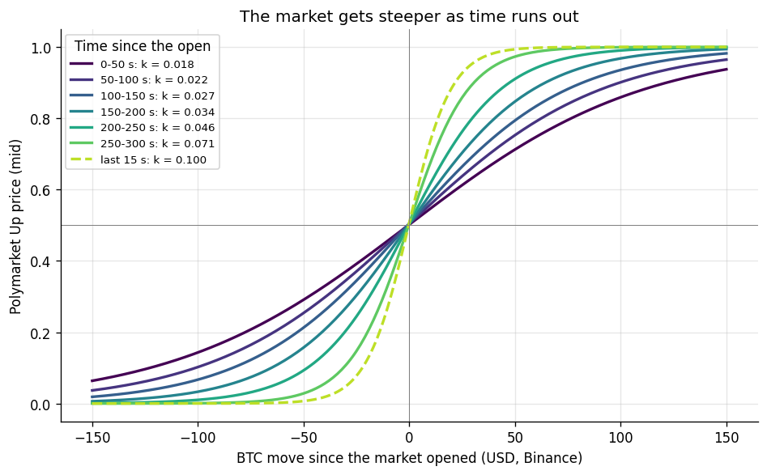

*Logistic curves fitted to the Up mid against the BTC move since the open, one per 50-second slice of the market and
one for the last 15 seconds, from one snapshot per second of 4,544 markets
([notebook 02](notebooks/02_polymarket_orderbook_calibration.ipynb), section 13).*

Early on a $50 move only takes the Up price from 0.50 to about 0.71, because BTC has plenty of time to come back. In
the last 50 seconds the same move takes it to about 0.97, and in the last 15 seconds to 0.99: the steepness `k` rises
from 0.018 to 0.071 (0.100 in the last 15 s). This is the narrowing distribution seen from the market's side. The fits
are looser late in the market (mean error 4.9¢ in the first 50 s, 11.2¢ in the last 50 s, 14.6¢ in the last 15 s),
because late prices jump towards 0 or 1.

## The data I collected

I recorded the live feeds on one server in Ireland: every Binance BTC/USDT trade, the best bid and ask of the current
Polymarket market every 100 ms, and every Polymarket trade. All were timestamped by the same clock on arrival, so the
timing between them does not depend on two clocks agreeing. The delays I measure include the network time from each
venue to my server, which is what a trader in the same place would see.

There are two captures: 9 days of Binance only (notebook 04 and the check in notebook 05), and 16 days of all feeds
plus the strike and result of about 4,500 markets (notebooks 01 to 03). For the lookup table I downloaded six months
of Binance trades (September 2025 to February 2026, 828 million trades), which Binance publishes as free monthly files
at [data.binance.vision](https://data.binance.vision/?prefix=data/spot/monthly/trades/BTCUSDT/).

**The recorder.** [`capture/collect.py`](capture/collect.py) is a cleaned version of the program I ran. It keeps three
public feeds open: Binance's trade stream, Polymarket's market stream (order book and trades) for the current market,
and Polymarket's market API for each market's strike and result. Every 5 minutes it switches to the new market. Data
goes to hourly CSV files, and each market's strike, close and outcome to `windows.csv`. Run it with
`python capture/collect.py`.

## How Polymarket follows Binance, and who makes money ([notebook 01](notebooks/01_polymarket_reaction_to_binance.ipynb))

21 March to 5 April 2026: 4,511 markets, 18.1 million Polymarket trades ($284 million) and 54.7 million Binance
trades. As a fair price I use the lookup table from notebook 05, driven by Binance. Ranges in brackets are 95%
intervals from resampling whole markets, because moments inside one market are not independent.

**Polymarket follows Binance within about a second.** I took every moment when Binance's move over the last second
changed the fair price by 3¢ or more (64,567 events, 172 an hour) and followed the mid. It had 61% of the fair move
after 0.5 s, 83% after 1 s and 89% after 2 s. The side takers hit (the ask after a rise) moves before the other side,
as it would if takers were clearing stale quotes. At random moments neither moves.

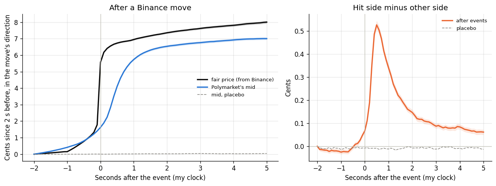

*Left: the fair price and the mid after an event, in the direction of the move, measured from 2 s before. Right: how
far the side takers hit is ahead of the other side. Dashed: the same at random moments.*

Without picking events, a regression of every 100 ms mid change on the Binance-driven fair-price changes around it
gives the same timing: half of the response after 500 ms, 90% after 1.3 s (1.2 to 1.3). About 10% is already in the
price 100 ms before my server sees the Binance trade, and the same on the exchanges' own clocks, so Polymarket partly
follows something faster than my Binance feed. Futures or other exchanges are a guess; I did not test which.

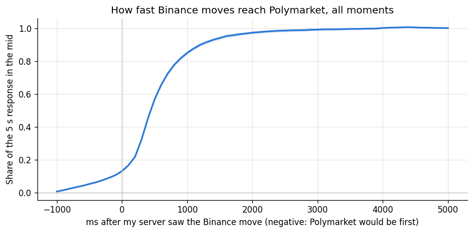

*Share of the 5 s response in the mid, by time after my server saw the Binance move, with a 95% band.*

**Speed is worth money for about half a second.** After each event I bought the side the move points to at the saved
quote a set delay later, paid the taker fee and held to settlement. With no delay this made 3.57¢ a share (3.31 to
3.82), at 500 ms 0.85¢ (0.58 to 1.12), at 700 ms nothing, and from 1 s on it lost. Real takers who traded the way of
the move show the same decline. This assumes every saved quote is filled instantly at the price shown. It neglects the
~10 ms an order needs to reach Polymarket and that someone faster may take the quote first, so it shows how long the
opportunity lasts, not a profit anyone could count on.

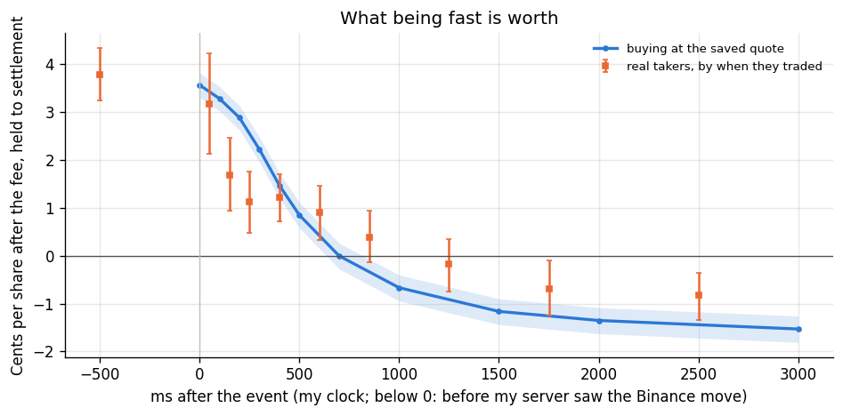

*Blue: buying at the saved quote a set delay after the event. Orange: real takers who went the way of the move, by when
they traded (below 0: before my server saw the Binance move).*

**Who makes money.** Every trade has a price, a size and a taker side, and every market an outcome, so each trade can
be valued at settlement and split between taker, maker and fee. I split takers by how far Binance had moved the fair
price their way in the second before the trade. Per day, over 15.7 days:

* Takers with Binance 2¢+ their way (12% of shares): **+$65k**, 1.55¢ a share (1.28 to 1.80).
* Takers with no Binance move behind them (70% of shares): **−$278k**, −1.14¢ a share (−1.23 to −1.05).
* All takers: −$338k. Makers: **+$118k** before rebates (95k to 146k), +$162k with the 20% rebate. Polymarket keeps
  **$176k** in fees.

Makers lose about $100k a day to the fast takers and win it back from takers with no Binance move behind them (+$132k)
and takers trading against a move (+$96k). This is the pattern Glosten and Milgrom (1985) describe: makers pay for
trading with better-informed traders out of the spread that everyone else pays.

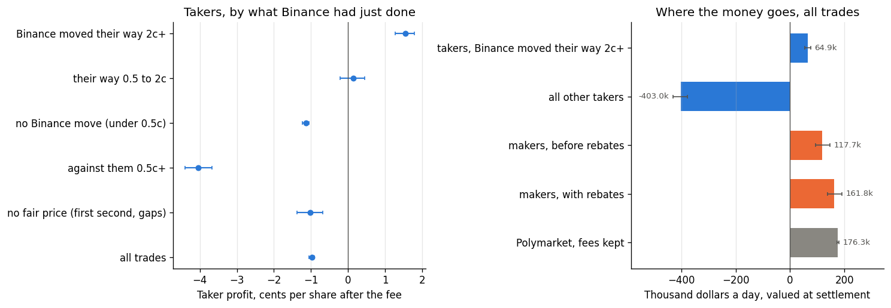

*Left: taker profit per share by what Binance had just done, with 95% intervals. Right: where the money goes, per day.*

**What holds up.** I reran the split changing one thing at a time: only trades printed on their taker side, Binance
read before the trade, raw dollar moves instead of the table, without the largest 1% of trades, without the last 10 s
of each market, prices 0.10 to 0.90 only, valued at the mid 30 s later, and each fee period; plus a placebo using the
Binance move from 60 s earlier. Fast takers win in every variant except the placebo, and on 16 of 16 days. Takers with
no move lose in every variant and on every day. The makers' profit is the fragile part: positive on 13 of 16 days, and
negative without the largest 1% of trades. Resampling whole hours instead of markets gives nearly the same intervals.

**The fee change.** On 30 March Polymarket raised the taker fee on crypto markets from 0.78¢ to 1.75¢ a share at a
price of 0.5 (now `0.07·p·(1−p)` dollars a share), with 20% of taker fees paid back to makers
([fee schedule](https://docs.polymarket.com/trading/fees)). Afterwards the market followed slightly faster (90% of the
response at 1.1 s against 1.4 s), buying 500 ms late paid 0.18¢ against 1.35¢, and takers with no move lost more per
share (−1.43¢ against −0.97¢). The two periods also differ in volatility and length, so this is a comparison, not a
measured effect of the fee.

**The data and the assumptions.** Recorded outcomes agree with the last-second price in 99.94% of the markets that
ended near 0 or 1. Polymarket's documentation defines a trade's `side` from the taker's point of view, and in every
group 90.6% to 95.0% of trades print on that side of the saved quote. Possible double records are at most 0.2% of
shares. The split is of trades, not
traders: the data has no account names, so "takers with no move" stand in for uninformed traders. Trades are valued as
if held to settlement. The fee formula and the 20% rebate come from Polymarket's documentation (the fee field in the
trade messages is constant), and liquidity rewards are not included.

### Why it lags: a latency race

When Binance moves, every quote resting on Polymarket is stale until it is updated, and whoever acts first gains: a
taker buys the stale ask, or a maker cancels it. Budish, Cramton and Shim (2015) show that this race is part of the Nash
equilibrium of a continuous order book: the fastest traders pick off stale quotes, and makers keep a spread wide enough
to pay for it. With a taker fee, a stale quote is only worth taking once the fair price has moved past the ask plus
the fee. The results above fit this picture (the hit side moves first, fast takers profit for about half a second, and
makers lose to them and recover from everyone else), but they do not test it against other explanations.

**My side of the race.** I built a market-making bot for this market, and for a maker, speed is defence: the sooner a
quote follows Binance, the less time it sits stale. Polymarket's matching engine is in London, so the bot ran in
Ireland, the closest region where Polymarket is available, about 10 ms from London (8 to 15 ms) and about 100 ms from
Binance. Normally a quote can change only once per round trip, because you need the order's ID before you can cancel
it. The ID is the hash of the signed order, so I computed it before sending and sent the cancel and the next order a
few milliseconds apart without waiting. With post-only orders priced far from the market, a cancel sent 3 ms after its
order worked every time (10 tries per gap). The news reaches London no sooner, but the quote can follow it every 3 ms
instead of every 20 to 25 ms. The tests are in [`order_speed/`](order_speed/). The bot never quoted for real.

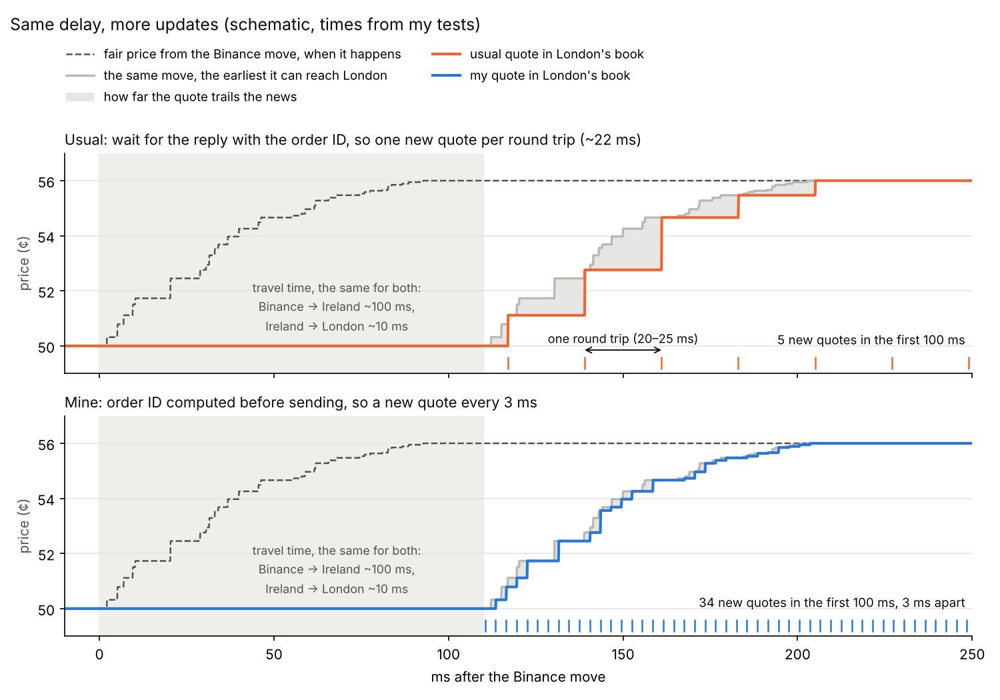

*Schematic with times from my tests. Both ways wait the same ~110 ms for the news to reach London; after that, the
usual way can change the quote once per round trip and mine every 3 ms. Polymarket's rate limits cap how long a burst
like this can last.*

## How good is the market's price? ([notebook 02](notebooks/02_polymarket_orderbook_calibration.ipynb))

**Polymarket's own price is well calibrated.** Across 4,544 markets (12.5 million 100 ms snapshots) the mid has a Brier
score of 0.1775 and a weighted mean calibration error of 0.97 percentage points; bid and ask are within 0.2 points of
that. Calibration alone does not make a forecast useful (always saying 50% would be calibrated if half the markets
settled Up); the Brier score also rewards confidence that turns out right, which is why it depends mainly on when you
look: 0.2201 with 200 s or more left, 0.1738 in the middle, 0.1287 with under 100 s left. The small pattern in the
errors (outcomes slightly below the price under 0.40, slightly above it from 0.50 to 0.80) is not distinguishable from
noise: 7 of 91 price levels have a 95% interval that excludes zero, close to the 4 or 5 expected by chance. The
snapshots of one market share one outcome, so the effective sample is the 4,544 markets. Page and Clemen (2013) found
Intrade's prices well calibrated close to resolution and less so far ahead; this checks the same for a market that
lasts five minutes.

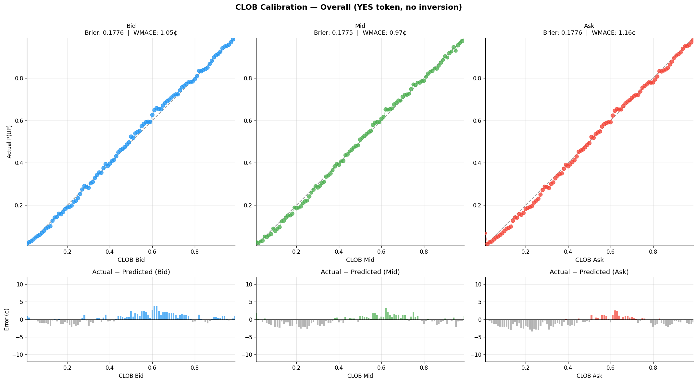

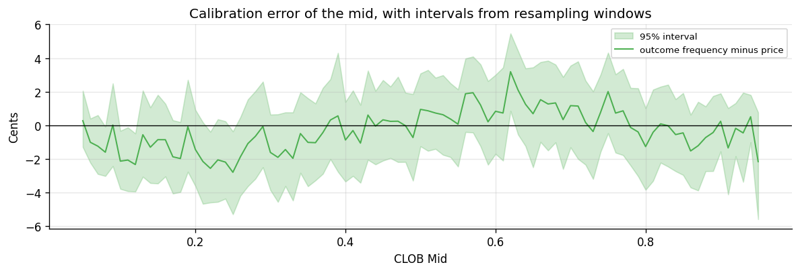

*The mid's calibration error by price, with 95% intervals from resampling markets.*

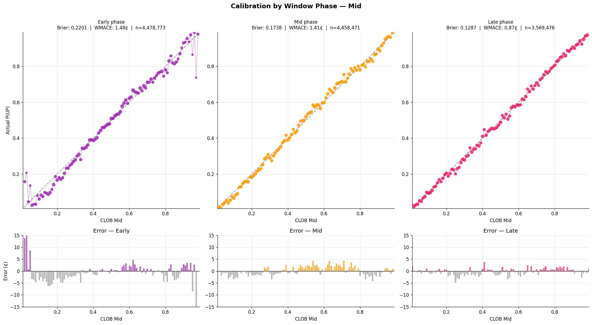

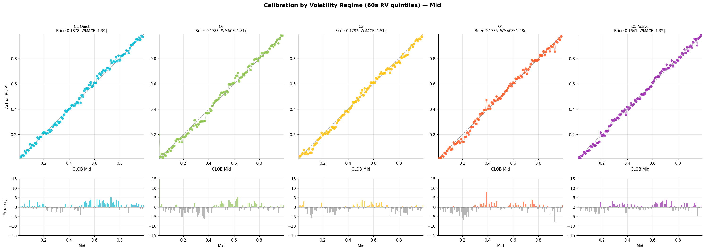

*By volatility regime (fifths of Binance's trailing 60 s volatility) the mid's Brier ranges from 0.1878 in the quietest
fifth to 0.1641 in the most active.*

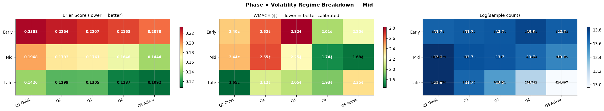

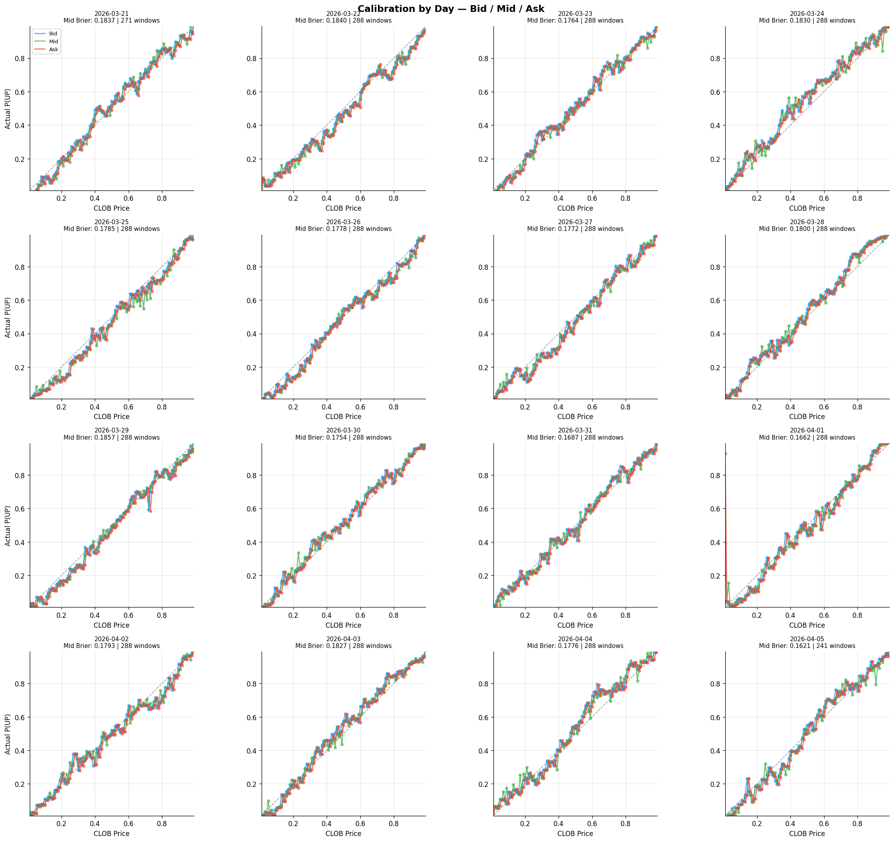

*Per-day mid Brier ranges from 0.1621 to 0.1857; 21 March and 5 April are partial days.*

**The spread** is one tick (1¢) 89% of the time. It is wider 10.9% of the time overall, 16.1% in the first 10 seconds of
a market and 28.9% in the last 10, and more often when Binance is volatile.

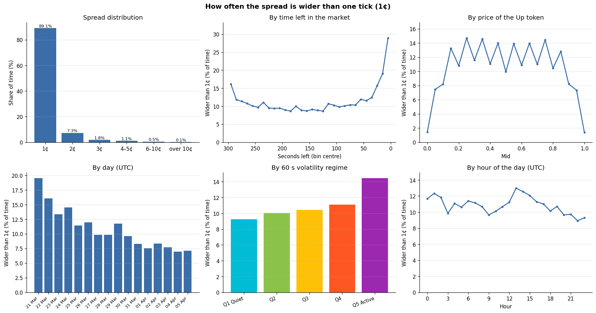

## How BTC moves over seconds ([03](notebooks/03_return_distributions_by_regime.ipynb), [04](notebooks/04_serial_correlation_and_volatility_window.ipynb))

Estimating the distribution of the final price means knowing how BTC moves over 1 to 300 seconds.

**Fat tails in every volatility regime** (notebook 03; 54.7 million trades, about 14 days). I measure them with a tail
ratio, the width of the 1st-to-99th percentile range over the width of the 10th-to-90th. A Normal distribution has
1.82; all 15 regime-by-horizon cells are between 2.26 and 3.41. I use it instead of kurtosis because here kurtosis is
dominated by a handful of moves: the largest 0.1% of samples supply 46% to 98% of it. Over days, Bitcoin returns
divided by realised volatility come out close to Normal (Takaishi, 2020); my moves are not scaled that way.

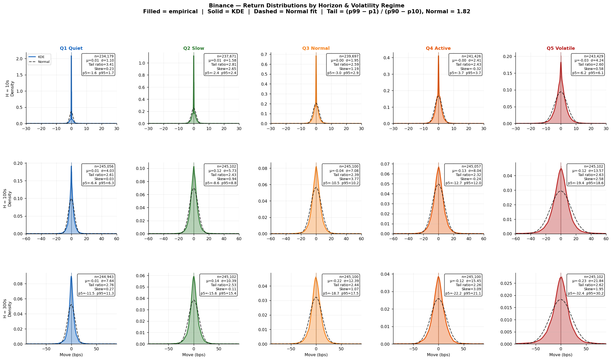

*Moves over 10, 100 and 300 s in each volatility regime (rows: horizon, columns: regime), against a Normal with the same
spread (dashed).*

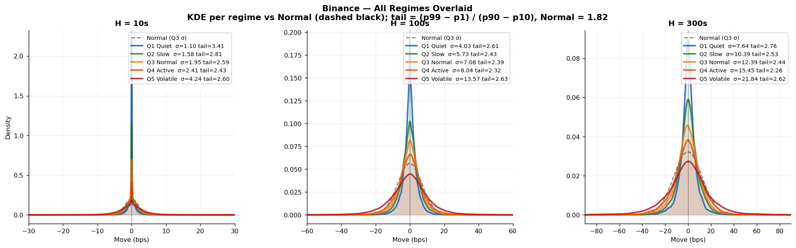

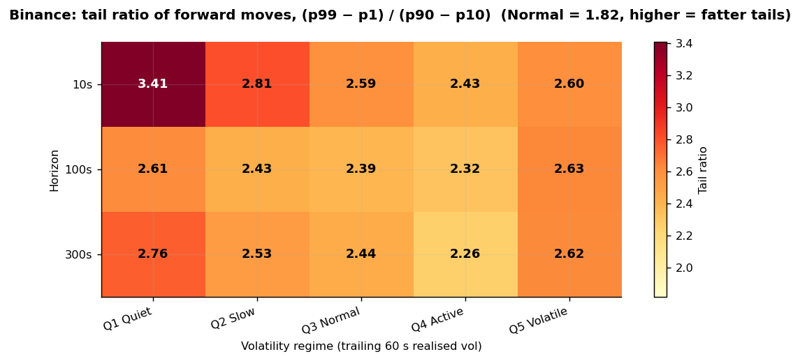

*Tail ratio `(p99 − p1) / (p90 − p10)` by volatility regime and horizon. A Normal distribution has 1.82.*

The spread of moves grows faster than the square root of time in calm regimes and slower in the most volatile one (10 s
to 300 s: ×6.9 in the calmest fifth, ×5.2 in the most volatile, against ×5.5 for constant volatility), consistent with
volatility drifting back towards its average. I did not test that separately.

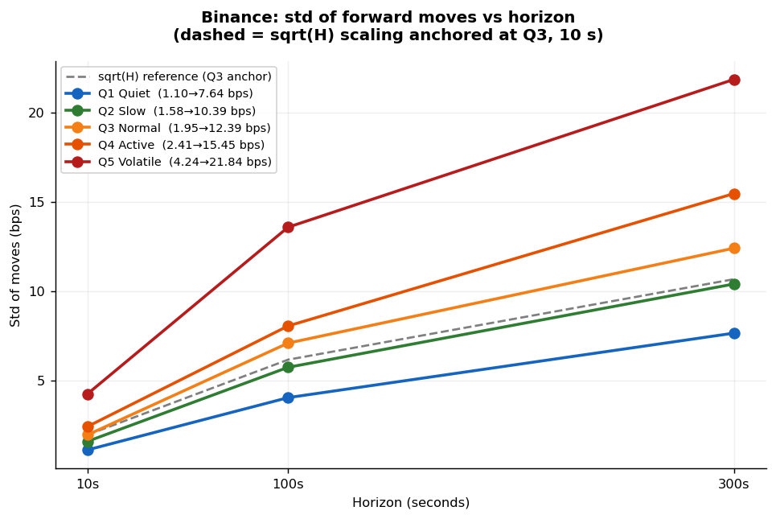

**Volatility is predictable, direction almost is not** (notebook 04). The autocorrelation of 100 ms returns is +0.18 at
one lag and about zero from 7.5 s. The next move has the same sign as the last one 60% of the time at 100 ms, under 50%
from 0.5 to 2 s, and at most 53.3% from 3 s on.

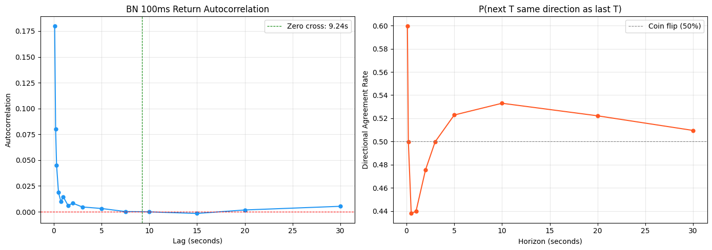

*Autocorrelation of 100 ms Binance returns (left) and how often the next move has the sign of the last (right).*

Trailing 60 s volatility separates calm from wild: the most volatile fifth has 3.15 times the next-minute spread of the
calmest. A 300 s window separates them more (3.53×) but was less stable between the two halves of the data, so the
table uses 60 s.

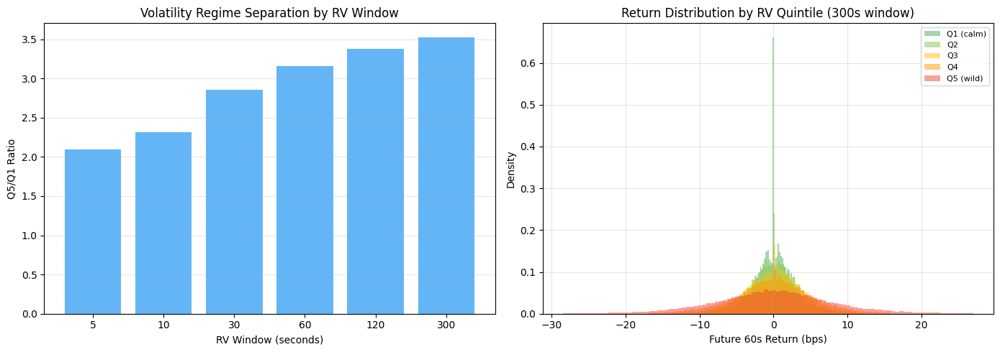

*Left: how well each trailing window separates the most volatile fifth from the calmest. Right: next-minute moves by
volatility fifth for the 300 s window.*

## Predicting Binance from six months of trades ([notebook 05](notebooks/05_conditional_cdf_grid_and_validation.ipynb))

**The lookup table.** To estimate the distribution without assuming its shape, I built a lookup table from six months
of Binance trades (828 million), using Binance's price as a stand-in for Chainlink's. Given the last 60 seconds of
volatility and the time left, it gives the distribution of the move until the close: 20 volatility bins of 5% of the
data each, by 56 time-left steps from 1 to 300 s, each cell holding the histogram of the moves that followed, from
−100 to +100 bps in 0.1 bp steps. To price a market I read the share of moves that would end above the strike. In
statistical-learning terms it is a nonparametric estimate of a conditional distribution; the binning is the one
modelling choice, a bias-variance trade-off.

**Using every second.** The question at any moment depends only on the volatility, the time left and the distance to
the strike, so every second of history counts as a moment in a market, once for each of the 56 time-left values. That
turns 15.6 million seconds into 875.7 million samples, about 780,000 per cell, and no cell is empty. The samples come
from overlapping windows, so the effective sample is roughly the count divided by the horizon: about 2,600 independent
moves per cell at 300 s. Seconds with no trade repeat the last price (7.6% of them), and the 0.028% of moves beyond
±100 bps are counted in the edge bins.

**Mirroring.** Every move is also added with its sign flipped, so the table carries no trend from the six months. This
is data augmentation that encodes one assumption, that over 5 minutes BTC is as likely to go up as down by the same
amount. It erases any real asymmetry too (in my March and April data the left tail of 300 s moves is slightly heavier
in every regime, notebook 03), but the trend was tiny: the average 5-minute move was −0.08 bps.

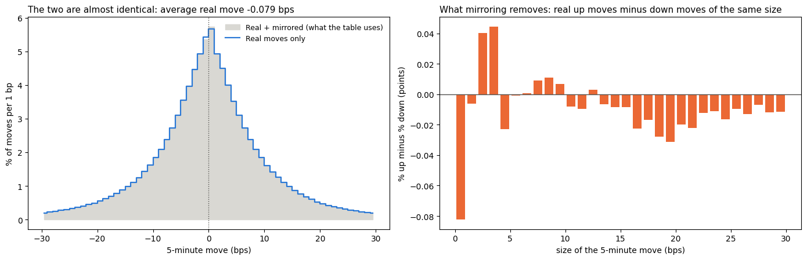

*Left: real 5-minute moves against the real-plus-mirrored mix the table uses. Right: what mirroring removes, the share
of up moves minus down moves of each size. Moves above about 10 bps lean down.*

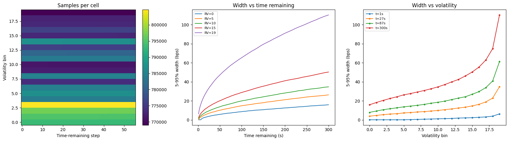

*Left: real samples per cell. Middle and right: the width of the middle 90% of moves grows with the time left and with
volatility. Even after the calmest minute, the next 5 minutes span about 16 bps.*

**Out-of-sample check.** I tested the table on 8 days of my own Binance capture (30.3 million trades), recorded after
the six months it was built from. Each test is a pseudo-market, "will Binance in t seconds be above where it was 300 s
ago?", asked every 5 seconds. With 60 s left the Brier score is 0.097 and the calibration error 0.7 percentage points
(0.071 and 0.7 at 30 s, 0.128 and 0.8 at 120 s); calibration is weaker at the shortest horizons, 2.1 points at 10 s and
3.7 at 5 s. The share of correct calls rises with the distance from the reference: 55% within 0.5 bp, 67% at 1 to
2 bps, 92% at 5 to 10 bps and 98% beyond 10 bps. Without the mirrored copies the Brier score is the same to four
decimals. A Normal distribution with each cell's spread does worse: calibration error 2.8 points at 60 s against 0.7,
and three to five times the table's from 30 s on. So the fat-tailed shape the table keeps is what makes its
probabilities calibrated. These scores answer a different question than the market's Brier in notebook 02 (Binance,
not Chainlink, on other days), so the two cannot be compared.

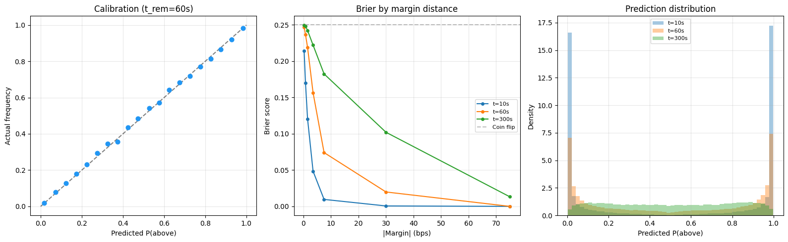

**Why it did not make money.** The table predicts Binance, but the market is decided by Chainlink's BTC/USD price.
Binance prices BTC in USDT, a stablecoin whose rate to the dollar drifts, while Chainlink reports US dollars as an
aggregate of many sources on its own schedule. In statistical-learning terms this is a distribution shift: trained on
one target, used on another. The gap matters most near the strike, where a bp or two decides the outcome (about one
prediction in six with 60 s left was within 2 bps of its reference). Converting the table's Binance probability into a
Chainlink one added more error than the table could make up, and the result scored worse than the market's own mid.
That experiment used price data I cannot publish, so it is described here but not included; that the USDT rate and
Chainlink's smoothing caused it is my reading, not a separate measurement. And the market sees the same Binance moves
within about a second (notebook 01). The lesson: in this market the hard part is predicting Chainlink's last price near
the strike, not Binance's distribution.

## Limitations

* **Short sample.** 8 to 16 days of live data from March and April 2026, one market regime. Moments inside a market are
  dependent, so notebooks 01 and 02 give intervals from resampling whole markets and notebook 03 from resampling days;
  the rest are point estimates.
* **Timing.** The book was saved every 100 ms, so times can read up to 100 ms high, and all times are on my clock in
  Ireland: Binance trades reached it a median 105 ms after their Binance timestamp (95th percentile 121 ms), Polymarket
  trade messages 11 ms after theirs. The speed results neglect the ~10 ms an order needs to reach Polymarket, and
  someone may be faster.
* **The fair price** is driven by Binance, a stand-in for the Chainlink price the market settles on.
* **Two fee periods** that differ in more than the fee: the second was calmer and shorter and included a holiday.
* **"60 s volatility"** is computed from summed squared one-second returns in notebook 01 and the table, and as a
  rolling standard deviation in notebooks 02 and 03, so values are not interchangeable between notebooks.
* **No trading claim.** The taker profits are what the race is worth to whoever is first, not a result I achieved.

## How this was made

The code in `notebooks/` and `capture/` was written by an AI assistant (Claude) from my instructions, and the Rust
order tests in `order_speed/` were also written with an AI assistant. I chose the questions, ran the data capture, the
notebooks and the tests, and judged the results; I did not write the code line by line. To reduce the risk of hidden
errors, the notebooks keep the outputs of my runs, notebook 01 runs its own stress tests, and the numbers in this README
were checked against those outputs. After their last run, notebooks 02 to 05 were trimmed without re-running: unused
imports, status messages, a repeated summary table and most progress logs were removed with their printed lines, and
overlapping labels in one heatmap of notebook 02 were fixed in the code. No number changed.

## What is not in this repo

Raw market data; the code of my trading bot (only the two order-speed tests are here); server addresses and
credentials; and experiments that used data sources other than public Binance trades and Polymarket's public market
data. Some notebooks were trimmed to remove those, and local paths in their outputs are shown under `data/`; otherwise
the printed outputs are those of my own runs. Two simpler models I tried, a HAR regression to forecast variance and a
closed-form Gaussian formula for the probability, are also left out: neither clearly beat a simple baseline. None of
the material left out produced a profitable strategy. No keys or wallet addresses are included.

## What is in the repo

| Path | What |
|---|---|
| [`notebooks/`](notebooks/) | Five notebooks, market first ([index](notebooks/README.md)) |
| [`figures/`](figures/) | Every figure the notebooks make, plus two illustrations |
| [`capture/collect.py`](capture/collect.py) | The data recorder (Binance trades, Polymarket's best bid and ask and trades, market results) |
| [`order_speed/`](order_speed/) | Two Rust tests of how fast my server could place and cancel an order on Polymarket |

## Data behind each notebook

| Notebook | Data used | Period | Size |
|---|---|---|---|
| 01 | Polymarket's best bid and ask, trades and outcomes, Binance trades (my capture); the lookup table from 05 | 21 March to 5 April 2026, 15.7 days of markets | 4,511 markets, 18.1 million Polymarket trades, 54.7 million Binance trades |
| 02 | Polymarket's best bid and ask and outcomes, Binance trades (my capture) | 21 March to 5 April 2026, 16 days | 4,544 markets |
| 03 | Binance trades (my capture) | 20 March to 5 April 2026, 17 calendar days with gaps, about 14.2 days of data | 54.7 million trades |
| 04 | Binance trades (my first capture) | 9 to 18 March 2026, 9 days | 32.0 million trades |
| 05, the check | Binance trades (part of my first capture) | 9 to 16 March 2026, 8 days | 30.3 million trades |
| 05, the lookup table | Binance's public monthly trade files (data.binance.vision) | September 2025 to February 2026, about 180 days | 828 million trades |

The dates of my first capture come from my notes.

## References

* Budish, E., Cramton, P. and Shim, J. (2015). The high-frequency trading arms race: Frequent batch auctions as a market design response. *The Quarterly Journal of Economics*, 130(4).
* Glosten, L. R. and Milgrom, P. R. (1985). Bid, ask and transaction prices in a specialist market with heterogeneously informed traders. *Journal of Financial Economics*, 14(1).
* Page, L. and Clemen, R. T. (2013). Do prediction markets produce well-calibrated probability forecasts? *The Economic Journal*, 123(568).
* Takaishi, T. (2020). Recent scaling properties of Bitcoin price returns. arXiv:2009.06874.

Released under the [MIT license](LICENSE).
